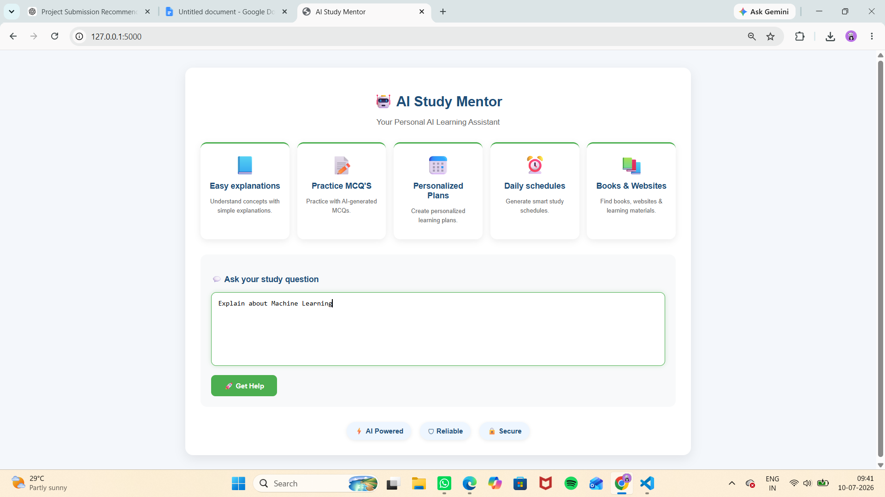
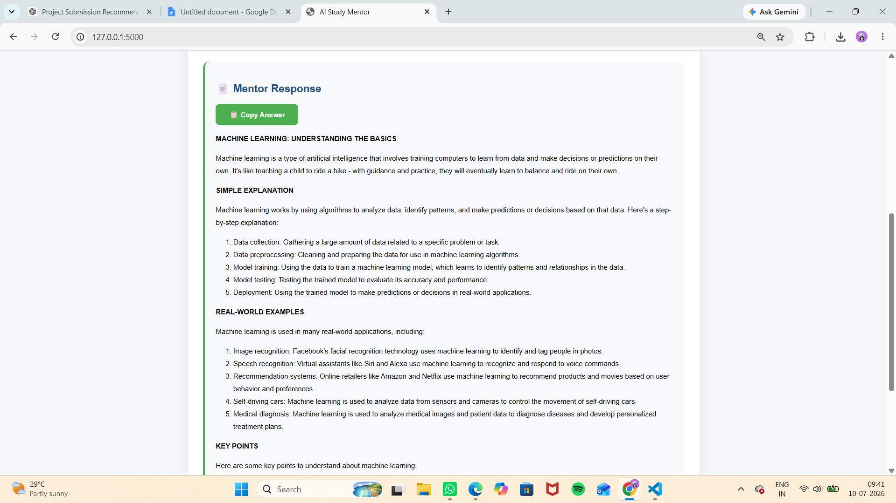
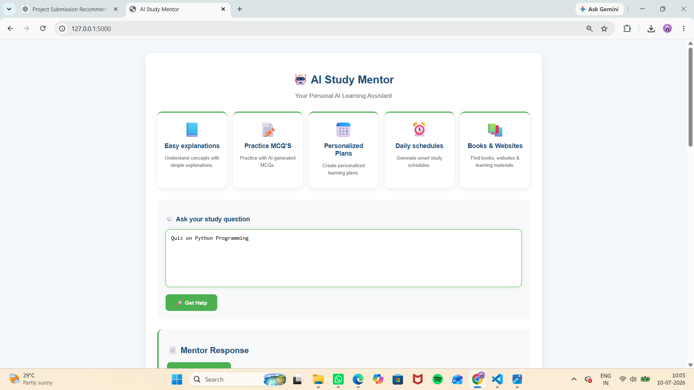
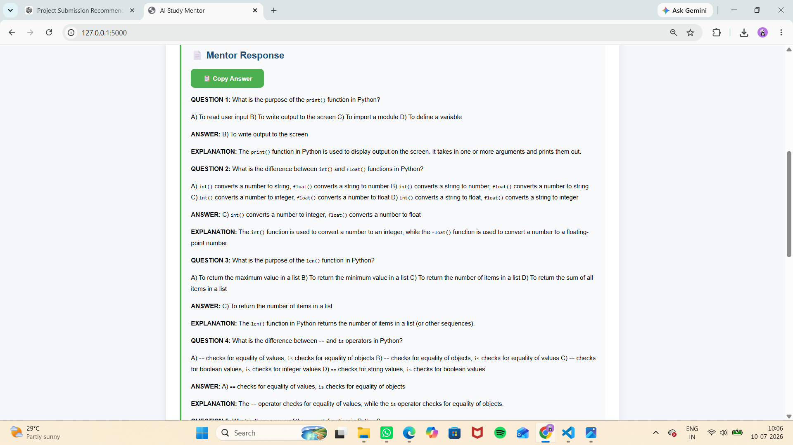
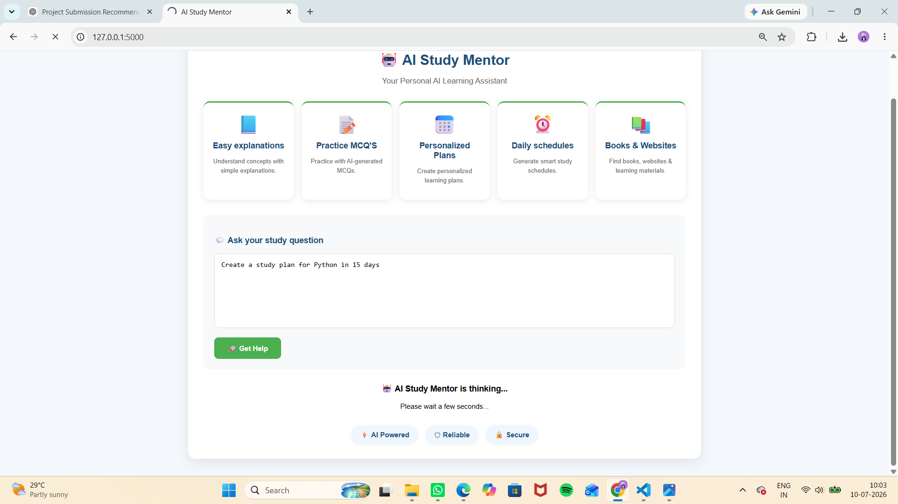
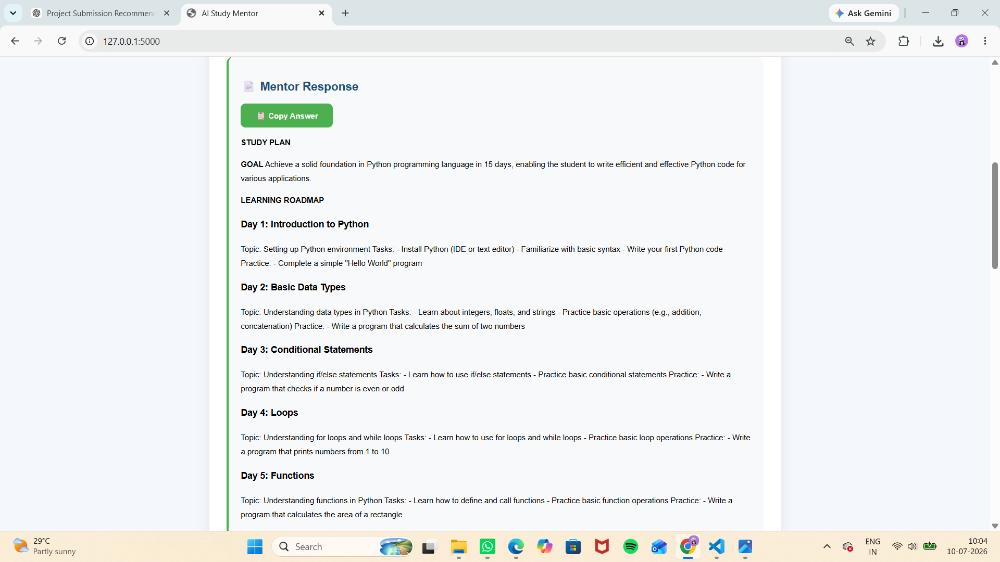
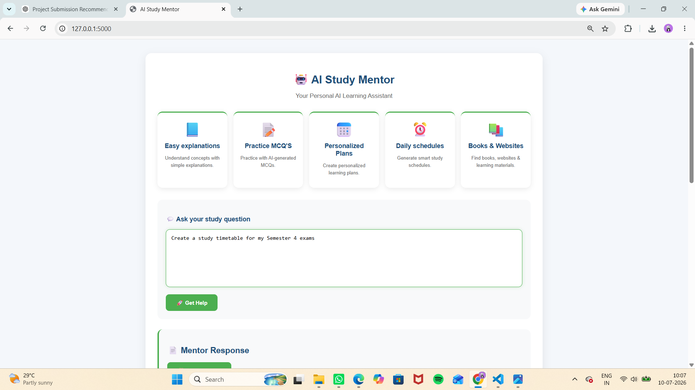
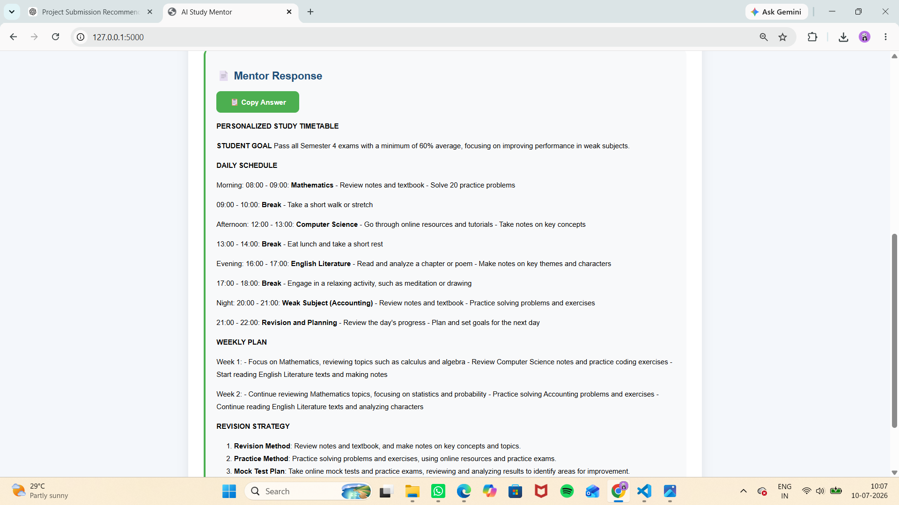
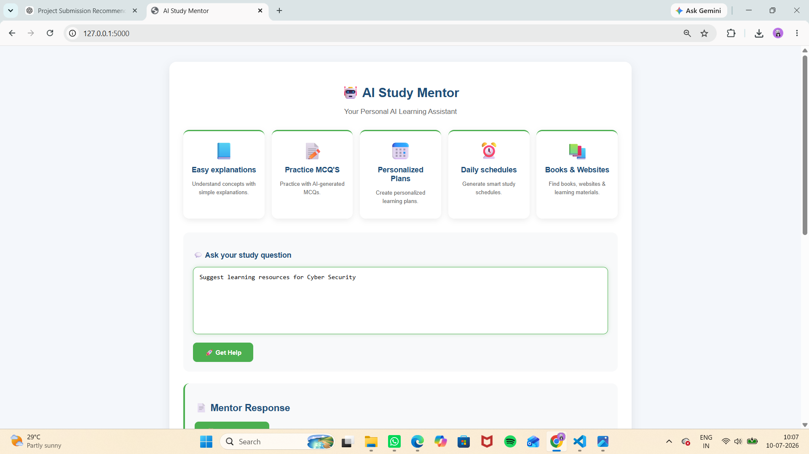
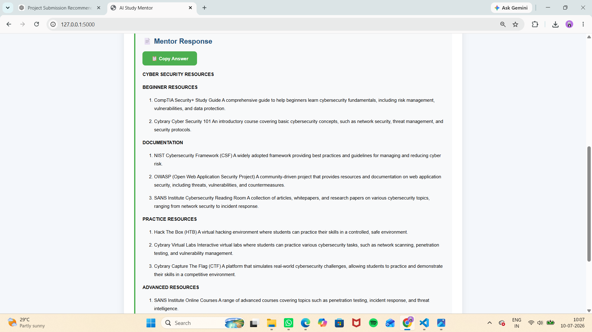

# 🤖 AI Study Mentor

## Overview

AI Study Mentor is an Agentic AI-based educational assistant that helps students with learning, revision, and exam preparation. The system uses multiple AI agents, where each agent performs a specialized task based on the student's request.

## 📸 Application Screenshots

### 🏠 Home Page

#### Home Screen


#### Home Screen with User Query


### 📖 Explanation Feature

#### Example 1



#### Example 2




### ❓ Quiz Generator

#### Example 1



#### Example 2




### 📅 Study Planner

#### Example 1



#### Example 2




### ⏰ Timetable Generator

#### Example 1



#### Example 2




### 📚 Learning Resources

#### Example 1



#### Example 2




## Features

- 📖 Explain study topics in simple language
- 📝 Generate quizzes with answers
- 📅 Create personalized study plans
- ⏰ Generate study timetables
- 📚 Recommend learning resources
- 👋 Detect greetings and respond appropriately
- 🎯 Intent Detection Agent routes requests to the correct AI agent
- 📋 Copy response feature
- ⏳ Loading animation for better user experience

## AI Agents

1. Intent Detection Agent
   - Detects the user's intention.

2. Explanation Agent
   - Explains concepts with examples and key points.

3. Quiz Generator Agent
   - Creates multiple-choice quizzes with answers.

4. Study Planner Agent
   - Generates personalized study plans.

5. Timetable Generator Agent
   - Creates study schedules based on user needs.

6. Learning Resource Agent
   - Recommends books, websites, courses, and practice platforms.

7. Mentor Agent
   - Used in the complete workflow for final response generation.

## Technologies Used

- Python
- Flask
- LangGraph
- LangChain
- Groq API (Llama 3.1)
- HTML
- CSS
- JavaScript

## ⚙️ Installation

### 1. Clone the Repository

```bash
git clone https://github.com/GayathriBannuri/AI-Study-Mentor.git
```

### 2. Open the Project Folder

```bash
cd AI-Study-Mentor
```

### 3. Install Required Packages

```bash
pip install -r requirements.txt
```

### 4. Create a `.env` File

Add your Groq API Key:

```env
GROQ_API_KEY=
```

### 5. Run the Project

```bash
python app.py
```

Open your browser and visit:

```
http://127.0.0.1:5000
```
## Project Workflow

User
   │
   ▼
Flask Web Application
   │
   ▼
Intent Detection Agent
   │
   ├───────────────┐
   ▼               ▼
Explanation      Quiz
Study Plan       Timetable
Resources
   │
   ▼
Mentor Agent
   │
   ▼
Formatted Response


## Project Structure

AI-Study-Mentor/

├── app.py
├── agents.py
├── requirements.txt
├── README.md
├── .gitignore
│
├── templates/
│   └── index.html
│
├── static/
│   └── style.css
│
└── docs/
    └── screenshots/
        ├── homepage.png
        ├── explanation.png
        ├── quiz.png
        ├── study-plan.png
        ├── timetable.png
        └── resources.png
        
## Future Scope

- User login system
- Progress tracking
- Voice interaction
- PDF export
- Database integration
- Chat history

## 👩‍💻 Author

**Gayathri Bannuri**

B.Tech Student | Cyber Security Student

Project developed as an Agentic AI educational assistant using Flask, LangGraph, and Groq LLM.